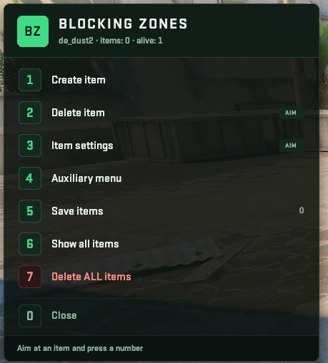
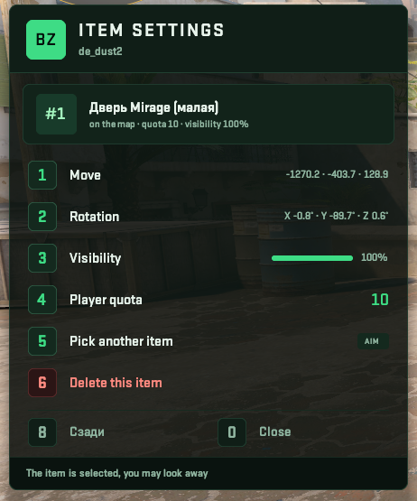
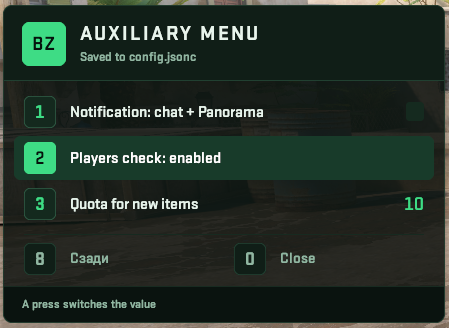

# BlockingZones-CS2



[English](#english) · [Русский](#русский)

## English

Author: **Rimmer**. A CS2 / CounterStrikeSharp plugin inspired by BlockingZones 1.3 (CS:GO, Drumanid).
While the server has few **alive** players, passages on the map are closed with props (`prop_dynamic`).
Every item has its own quota: it stays while alive T+CT players are **fewer** than its quota.

Current version: **0.1.0**. Needs CounterStrikeSharp 1.0.374+ (built against 1.0.377, .NET 10) and
[PanoramaMenuManager](https://github.com/RRimmer/PanoramaMenuManagerCS2) core **1.3.00+**.

- Own green Panorama layout **bz**: menu, preview key strip, "Part of the map is closed" banner.
  Controlled **only with number keys** 1–9 and 0 (PMM `NumberKeyPressed`): no mouse, no chat commands.
- Per-item quota, only alive T+CT are counted (bots optional), nothing spawns in warmup.
  Spawn on `round_freeze_end` with a fallback timer.
- Placement preview: a ghost follows the crosshair and lines up with the surface normal; 1 place, 2/3/4 rotate X/Y/Z, 5 reset, 0 cancel.
- Item settings: move (forward / back / left / right from the view, up / down, put back), rotation, visibility, quota, delete.
  Move and rotation steps are switched with key 7 and set in the config (`MoveSteps`, `RotateSteps`).
- One JSON per map (`maps/<map>.json`, `maps/workshop/<id>/<map>.json`), `config.jsonc` and `items.jsonc` with comments.
- Notifications: chat and / or the bz banner with fade in / out and a countdown bar.
- `templates/de_mirage.json` — a ready de_mirage layout converted from a CS:GO config (not created automatically).

### Screenshots

| Main menu | Item settings | Auxiliary menu |
| --- | --- | --- |
|  |  |  |

### Repository layout

| Folder | What it is |
| --- | --- |
| `BlockingZones` | The plugin: `Plugin.cs` (commands, events, round logic), `Menus.cs` (screens and keys), `Preview.cs` (ghost), `Props.cs` (spawn, render, trace), `Hud.cs` (bz layout driver), `Notify.cs` (chat / banner), `Storage.cs` (files), `Config.cs`, `Templates.cs` (commented config) |
| `BlockingZones/lang` | `ru.json`, `en.json` |
| `BlockingZones/panorama` | Client files for the MultiAddonManager addon: `bz.xml`, `bz.css` |
| `tools` | `gen_layout.py` — generates the panorama files (`python3 tools/gen_layout.py`); `build-addon.cmd` — compiles them into your client addon |
| `MenuManagerApi` | Compile-time library (PMM core 1.3.00 API). Do not copy `MenuManagerApi.dll` next to this plugin |
| `configs` | Example `config.jsonc` and `items.jsonc` |
| `templates` | Ready map layouts to copy by hand |
| `screenshots` | In-game screenshots |

### Build

```
dotnet build BlockingZones.sln -c Release
```

or `BlockingZones\build.cmd` (log in `build.log`). Output: `BlockingZones/bin/Release/net10.0/` — `BlockingZones.dll` and `lang/`.

### Install

See [INSTALL.md](INSTALL.md).

Commands: `css_bz` / `!bz` (open / close the menu, `AdminFlag`), `css_bz_reload` (re-read `config.jsonc` and `items.jsonc`).

Admins need the PMM number-key binds:
`bind "1" "css_1; slot1"` … `bind "0" "css_0; slot10"`. If they are missing, `!bz` prints the line into the console.

### Author

**Rimmer**. Inspired by BlockingZones 1.3 (CS:GO, Drumanid).

License: GPL-3.0.

---

## Русский

Автор: **Rimmer**. Плагин для CS2 / CounterStrikeSharp, вдохновлён BlockingZones 1.3 (CS:GO, Drumanid).
Пока на сервере мало **живых** игроков, проходы на карте закрываются предметами (`prop_dynamic`).
У каждого предмета своя квота: предмет стоит, пока живых игроков T+CT **меньше** его квоты.

Текущая версия: **0.1.0**. Нужны CounterStrikeSharp 1.0.374+ (собрано под 1.0.377, .NET 10) и
[PanoramaMenuManager](https://github.com/RRimmer/PanoramaMenuManagerCS2) core **1.3.00+**.

- Своя зелёная панорама **bz**: меню, полоса клавиш предпросмотра, баннер «Часть карты закрыта».
  Управление **только цифрами** 1–9 и 0 (`NumberKeyPressed` PMM): без мыши и без чат-команд.
- Квота на каждый предмет, считаются только живые T+CT (боты — по настройке), в разминке предметы не спавнятся.
  Спавн на `round_freeze_end` с резервным таймером.
- Предпросмотр установки: призрак за прицелом, ориентация по нормали поверхности; 1 поставить, 2/3/4 поворот X/Y/Z, 5 сброс, 0 отмена.
- Настройки предмета: передвинуть (вперёд / назад / влево / вправо от взгляда, вверх / вниз, вернуть), поворот, видимость, квота, удаление.
  Шаги передвижения и поворота переключаются клавишей 7 и задаются в конфиге (`MoveSteps`, `RotateSteps`).
- JSON на каждую карту (`maps/<map>.json`, `maps/workshop/<id>/<map>.json`), `config.jsonc` и `items.jsonc` с комментариями.
- Уведомления: чат и / или баннер bz с плавным появлением и угасанием и полоской-таймером.
- `templates/de_mirage.json` — готовая раскладка de_mirage, перенесённая из конфига CS:GO (сама не создаётся).

### Скриншоты

| Главное меню | Настройки предмета | Дополнительное меню |
| --- | --- | --- |
|  |  |  |

### Состав репозитория

| Папка | Что это |
| --- | --- |
| `BlockingZones` | Плагин: `Plugin.cs` (команды, события, логика раунда), `Menus.cs` (экраны и клавиши), `Preview.cs` (призрак), `Props.cs` (спавн, рендер, трейс), `Hud.cs` (управление панорамой bz), `Notify.cs` (чат / баннер), `Storage.cs` (файлы), `Config.cs`, `Templates.cs` (конфиг с комментариями) |
| `BlockingZones/lang` | `ru.json`, `en.json` |
| `BlockingZones/panorama` | Клиентские файлы для аддона MultiAddonManager: `bz.xml`, `bz.css` |
| `tools` | `gen_layout.py` — генерирует файлы панорамы (`python3 tools/gen_layout.py`); `build-addon.cmd` — компилирует их в ваш клиентский аддон |
| `MenuManagerApi` | Библиотека только для сборки (API PMM core 1.3.00). `MenuManagerApi.dll` рядом с этим плагином не клади |
| `configs` | Пример `config.jsonc` и `items.jsonc` |
| `templates` | Готовые раскладки карт, копируются вручную |
| `screenshots` | Скриншоты из игры |

### Сборка

```
dotnet build BlockingZones.sln -c Release
```

или `BlockingZones\build.cmd` (лог в `build.log`). Результат: `BlockingZones/bin/Release/net10.0/` — `BlockingZones.dll` и `lang/`.

### Установка

См. [INSTALL.md](INSTALL.md).

Команды: `css_bz` / `!bz` (открыть / закрыть меню, `AdminFlag`), `css_bz_reload` (перечитать `config.jsonc` и `items.jsonc`).

Админам нужны бинды цифр PMM:
`bind "1" "css_1; slot1"` … `bind "0" "css_0; slot10"`. Если их нет, `!bz` печатает строку в консоль.

### Автор

**Rimmer**. Вдохновлён BlockingZones 1.3 (CS:GO, Drumanid).

Лицензия: GPL-3.0.
